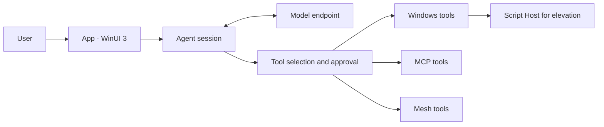

# WindowsAxon

WindowsAxon is a Windows 11 x64 desktop assistant built with WinUI 3 and .NET 10.
It uses an OpenAI-compatible model endpoint to turn plain-text requests into tool calls.
It can read files, inspect Windows settings, and work with desktop apps and browsers.
Skills provide reusable instructions, and MCP servers add external tools.

## Quick start

1. Download the App executable from [GitHub Releases](https://github.com/wooly905/WindowsAxon/releases).
2. Start an OpenAI-compatible model service.
3. Open the App and set the endpoint URL, model name, and API mode in **Settings**.

The default URL is `http://localhost:11434/v1`.
The default model is `auto`.
Keep `auto` if your endpoint routes requests to a model.
If your endpoint requires a model name, enter the name it serves in **Settings**.

A remote model endpoint receives conversation messages and tool results.
The App keeps its settings, chat history, and audit logs under `%LOCALAPPDATA%\WindowsAxon`.
The App stores API keys entered in **Settings** in Windows Credential Manager.

## Structure and design



| Project | Responsibility |
| --- | --- |
| [WindowsAxon.App](src/WindowsAxon.App) | Hosts the chat UI and builds sessions from the configured model, tools, skills, and network mode. |
| [WindowsAxon.Agent](src/WindowsAxon.Agent) | Runs the agent loop and manages tool selection, approval, audit logs, and model protocols. |
| [WindowsAxon.Windows](src/WindowsAxon.Windows) | Implements tools for Windows, file access, desktop controls, browsers, and scripts. |
| [WindowsAxon.ScriptHost](src/WindowsAxon.ScriptHost) | Runs approved scripts that need administrator rights in a separate process. |
| [WindowsAxon.Mesh](src/WindowsAxon.Mesh) | Handles peer discovery, task dispatch, parallel work, MapReduce, and file transfer. |
| [WindowsAxon.Hub](src/WindowsAxon.Hub) | Relays WebSocket messages in Central Server mode and serves the online node dashboard. |
| [WindowsAxon.Eval](src/WindowsAxon.Eval) | Runs agent evaluation cases with a configured model and simulated tools. |

The agent checks the approval policy before executing a tool call.
**Settings** offers **Ask for every action**, **Allow reads**, **Allow actions on this computer**, and **Allow all actions**.
The default **Allow reads** level runs ordinary reads without a prompt.
The agent binds each one-time approval to the specific call and its arguments.

## Network modes

- **Standalone** is the default. Requests run on the current computer.
- **Peer-to-Peer (same LAN)** discovers peers that use the same pair key. Peers communicate over encrypted connections.
- **Central Server** routes messages through `WindowsAxon.Hub`. The Hub relays requests to the target App.

In **Network**, select a mode and set a name for each computer.
Select an online computer to address a request with `@<name>`.
The target computer runs the agent session and sends required approvals back to the caller.

For Central Server mode, start the Hub executable and set **Hub URL** in each App.
Use `ws://<hub-host>:5250/ws` for the default Hub listener.
The same listener serves `/health`.
Set `WINDOWSAXON_HUB_TOKEN` on the Hub and enter the same token in the App to require WebSocket authentication.
The separate node dashboard and `/api/nodes` use port `80` by default and have no authentication.

## Build and release

Install the Windows .NET SDK selected by [global.json](global.json).
Run these commands from the repository root.

```powershell
dotnet build WindowsAxon.slnx
dotnet test --solution WindowsAxon.slnx
dotnet run --project src/WindowsAxon.App
```

The CD workflow publishes two self-contained Windows x64 executables. [Workflow](.github/workflows/cd.yml)

- `WindowsAxon.App.win-x64.exe`
- `WindowsAxon.Hub.win-x64.exe`

Each executable is a single file and has a matching `.sha256` checksum file.
The release tag and executable file versions use the same build version. [Version settings](Directory.Build.props)
